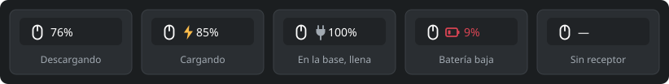
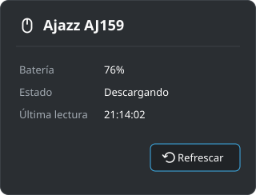

# Batería AJ159 para KDE Plasma

Widget para el panel de KDE Plasma 6 que muestra en todo momento el porcentaje de batería del mouse inalámbrico **Ajazz AJ159**.


## Tabla de contenidos

- [Descripción](#descripción)
- [Características](#características)
- [Stack tecnológico](#stack-tecnológico)
- [Requisitos](#requisitos)
- [Instalación](#instalación)
- [Uso](#uso)
- [Cómo funciona](#cómo-funciona)
- [Estructura del proyecto](#estructura-del-proyecto)
- [Solución de problemas](#solución-de-problemas)
- [Desinstalación](#desinstalación)
- [Créditos](#créditos)
- [Licencia](#licencia)

## Descripción

> **Proyecto personal.** Hice este widget para mi propio equipo: CachyOS con KDE Plasma 6 (Wayland) y mi mouse **Ajazz AJ159**. Solo lo he probado en ese entorno y con ese periférico. Para mi headset, el Logitech G733, hice otro widget aparte: [g733-battery-plasmoid](https://github.com/Rafael-Ibarra-Beltran/g733-battery-plasmoid).

Ajazz solo ofrece para Windows el programa que muestra la batería del AJ159. En Linux no hay una forma integrada de saber cuánta batería le queda al mouse.

Este proyecto añade un widget (plasmoide) al panel de KDE Plasma que lee la batería directamente del receptor inalámbrico, o del mouse si está conectado por cable, y la muestra junto a la bandeja del sistema. El widget no depende de servicios en segundo plano ni de programas externos.

## Características

- **Porcentaje siempre visible** en el panel, sin pasar el cursor por encima.
- **Estado de carga:** ⚡ mientras carga (en la base o por cable) y 🔌 cuando está conectado pero ya no carga (batería llena).
- **Aviso de batería baja:** por debajo del 15 % aparecen un ícono rojo y el número en rojo, sin ventanas emergentes.
- **Modo inalámbrico y por cable:** si están los dos, usa el cable.
- **Tolera la suspensión del mouse:** cuando el mouse se duerme, conserva la última lectura y reintenta cada 30 segundos.
- **Panel de detalle** al hacer clic, con el estado, la hora de la última lectura y un botón **Refrescar**.
- **Lectura cada 60 segundos.**
- **Sin dependencias:** solo QML de Plasma y Python 3 con su biblioteca estándar.





## Stack tecnológico

| Componente | Tecnología |
|------------|------------|
| Interfaz | QML · Plasma 6 (`org.kde.plasma.plasmoid`) · Kirigami · Plasma Components 3 |
| Ejecución del lector | `org.kde.plasma.plasma5support` (DataSource `executable`) |
| Lector de batería | Python 3, solo biblioteca estándar · *feature reports* HID por `ioctl` sobre `/dev/hidraw*` |
| Permisos | Regla udev con `TAG+="uaccess"` |
| Empaquetado | `kpackagetool6` (KPackage `Plasma/Applet`) |

## Requisitos

- KDE Plasma 6.
- Python 3.
- Mouse Ajazz AJ159 con su receptor inalámbrico (`248a:5b2f`) o conectado por cable (`248a:5b2e`).

## Instalación

1. Clona el repositorio:

   ```sh
   git clone https://github.com/Rafael-Ibarra-Beltran/aj159-battery-plasmoid.git
   cd aj159-battery-plasmoid
   ```

2. Instala la regla udev para que tu usuario pueda leer el receptor sin `sudo` (solo una vez):

   ```sh
   sudo install -m644 udev/70-aj159-battery.rules /etc/udev/rules.d/
   sudo udevadm control --reload
   sudo udevadm trigger
   ```

3. Comprueba que el lector funciona:

   ```sh
   python3 package/contents/code/aj159-battery
   ```

   Debe imprimir algo como:

   ```json
   {"status": "ok", "mode": "wireless", "battery": 76, "charging": false, "powered": false, "error": null}
   ```

4. Instala el widget:

   ```sh
   ./install.sh
   ```

5. Haz clic derecho en el panel, elige **Añadir widgets…**, busca **Batería AJ159** y arrástralo junto a la bandeja del sistema.

Para actualizar a una versión nueva, ejecuta `./install.sh` otra vez y reinicia Plasma:

```sh
systemctl --user restart plasma-plasmashell
```

## Uso

| Panel | Significado |
|-------|-------------|
| `76%` | Descargando (en uso) |
| `⚡85%` | Cargando, en la base o por cable |
| `🔌100%` | Conectado, carga terminada |
| ícono rojo + `9%` | Batería baja (menos del 15 %) |
| `—` | Mouse apagado o receptor desconectado, sin lecturas previas |

Al hacer clic en el widget se abre el panel de detalle. **Refrescar** hace una lectura inmediata.

El mouse calcula el porcentaje a partir del voltaje, así que puede variar un poco entre lecturas.

## Cómo funciona

```
main.qml ──(cada 60 s)──▶ aj159-battery (Python) ──▶ /dev/hidrawN (receptor o cable) ──▶ mouse
    ▲                             │
    └──────────── JSON ◀──────────┘
```

1. El widget ejecuta `package/contents/code/aj159-battery`.
2. El script busca en `/sys/class/hidraw` la interfaz 1 del receptor (`248a:5b2f`) o del mouse por cable (`248a:5b2e`).
3. Pide el estado con un *feature report* HID, interpreta la respuesta e imprime una línea JSON.
4. El widget muestra el resultado.

### Protocolo

Se usa el *feature report* `0x0C` de 33 bytes de la interfaz USB 1:

1. Se envía `0c 01 20 00 <seq>` seguido de ceros con `HIDIOCSFEATURE`. `<seq>` es un número de secuencia que debe cambiar en cada petición: el receptor ignora una petición con la misma secuencia que la anterior.
2. Se lee la respuesta con `HIDIOCGFEATURE`:

| Byte | Significado |
|------|-------------|
| `rx[2]` | `0x20` (eco del comando) |
| `rx[6]` | Longitud del payload (`0` = sin dato todavía) |
| `rx[0x12]` | Batería en % (`0` = sin lectura) |
| `rx[0x13]` | `1` cargando (en la base o por cable), `2` llena, `0` descargando |

Es el protocolo de la familia de receptores Compx, que usan Ajazz y otras marcas.

## Estructura del proyecto

```
aj159-battery-plasmoid/
├── package/
│   ├── metadata.json             # Metadatos del plasmoide
│   └── contents/
│       ├── code/aj159-battery    # Lector de batería (Python)
│       └── ui/main.qml           # Interfaz del widget
├── udev/70-aj159-battery.rules   # Permiso de acceso al receptor
├── docs/images/                  # Imágenes del README
├── install.sh                    # Instala o actualiza el widget
└── LICENSE
```

## Solución de problemas

| Síntoma | Solución |
|---------|----------|
| "Sin permiso: instala la regla udev" | Instala la regla (paso 2 de la instalación) y desconecta y vuelve a conectar el receptor. |
| "Receptor no encontrado" | Comprueba que el receptor está conectado: `lsusb \| grep 248a`. |
| "Dormido (mostrando la última lectura)" | El mouse está en reposo. Muévelo y la lectura se actualiza en menos de 30 segundos. |
| El widget no se actualiza tras `./install.sh` | Reinicia Plasma: `systemctl --user restart plasma-plasmashell`. |

Para depurar, `python3 package/contents/code/aj159-battery --raw` imprime además en stderr los bytes de la respuesta.

## Desinstalación

```sh
kpackagetool6 -t Plasma/Applet --remove aj159-battery
sudo rm /etc/udev/rules.d/70-aj159-battery.rules
```

## Créditos

- [whiskerd](https://github.com/Zamiul-rashid/whiskerd) (MIT): documentación del protocolo de los receptores Compx.

Ajazz y AJ159 son marcas de sus respectivos propietarios. Este proyecto no está afiliado a Ajazz.

## Licencia

Distribuido bajo la licencia MIT. Consulta [LICENSE](LICENSE).
